# Procedimiento

Este documento registra paso a paso lo que fuimos haciendo, con las capturas que verifican cada resultado. Está pensado para leerse en orden.

Las partes siguen la numeración de [`GUIA.md`](GUIA.md), donde están la teoría y los comandos. Dentro de cada parte, los apartados agrupan los pasos de la guía según las capturas, así que su numeración no siempre coincide uno a uno con la de la guía. Los requisitos del trabajo están en [`CONSIGNA.md`](CONSIGNA.md).

| Parte | Tema | Código |
|---|---|---|
| 1 | Preparar el entorno | — |
| 2 | La app mínima | `HelloPkg/SimplestApp/` |
| 3 | Hello World con la System Table | `HelloPkg/HelloWorld/` |
| 4 | Hello World con las bibliotecas de EDK2 | `HelloPkg/HelloPrint/` |
| 5 | Depuración con GDB | `HelloPkg/HelloWorld/` + `scripts/` |
| 6 | El Hello World en hardware real (bare metal) | los mismos `.efi` + la Shell de `ShellPkg` |

Todas las sesiones de depuración se hicieron con **gdb-dashboard**.

---

# Parte 1: preparar el entorno

## 1.1 Herramientas y EDK2

```bash
sudo apt install build-essential git uuid-dev iasl nasm python3 qemu-system-x86 gdb
git clone --branch edk2-stable202608 --depth 1 https://github.com/tianocore/edk2 ~/edk2
cd ~/edk2 && git submodule update --init --depth 1
make -C ~/edk2/BaseTools -j$(nproc)
```

## 1.2 OVMF en DEBUG

```bash
cd ~/practico-3
make ovmf
```

Compilamos OVMF nosotros en DEBUG, en lugar de usar el de la distro, porque esa versión escribe por el puerto `0x402` un log con la dirección donde carga cada imagen, y ese dato es imprescindible para la Parte 5.

## 1.3 Verificación

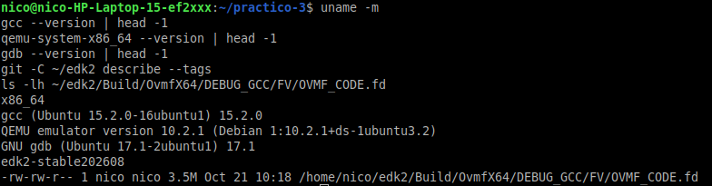

| Herramienta | Versión |
|---|---|
| Arquitectura | `x86_64` |
| gcc | 15.2.0 (Ubuntu 15.2.0-16ubuntu1) |
| QEMU | 10.2.1 |
| GDB | 17.1 |
| EDK2 | `edk2-stable202608` |
| `OVMF_CODE.fd` | 3.5 MB, en `~/edk2/Build/OvmfX64/DEBUG_GCC/FV/` |

---

# Parte 2: la app mínima

## 2.1 Compilar

```bash
make
```

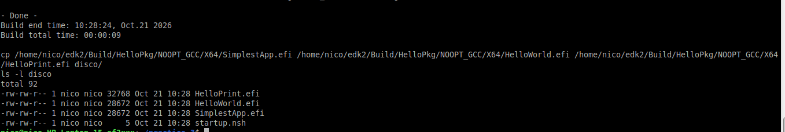

`build` compila `HelloPkg.dsc` con el target `NOOPT` (`-O0` + símbolos) y termina en `- Done -`. El `Makefile` copia los tres `.efi` a `disco/`: `SimplestApp.efi` y `HelloWorld.efi` de 28672 bytes y `HelloPrint.efi` de 32768. Los `Error 1 (ignored)` que aparecen durante la compilación corresponden a la copia de archivos `.pdb`, que solo existen en Windows: no afectan el resultado.

## 2.2 El ejecutable es PE/COFF

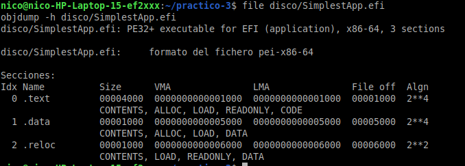

`file` reconoce `PE32+ executable for EFI (application), x86-64, 3 sections` y `objdump` lo lee como `pei-x86-64`. Aunque lo compiló gcc en Linux, `GenFw` convirtió el ELF al formato PE/COFF que exige la especificación UEFI. Tiene tres secciones: `.text` (código) en `0x1000`, `.data` en `0x5000` y `.reloc` en `0x6000`. Esta última es la **información de reubicación**, la que le permite al firmware cargar la imagen en cualquier dirección.

## 2.3 La UEFI Shell

```bash
make run
```

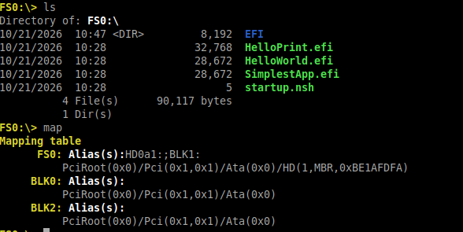

La primera vez, OVMF se quedó en `BdsDxe: No bootable option or device was found`. La Shell interna está registrada como opción de categoría *aplicación*, y BDS solo arranca solas las de categoría *boot*. Por eso probó nuestro disco, que no tenía un cargador en la ruta por defecto `\EFI\BOOT\BOOTX64.EFI`. Lo resolvimos con `make run`, que copia `Shell.efi` a esa ruta. Así BDS arranca la UEFI Shell desde nuestro disco, y `disco/` aparece como `FS0:`.

`ls` muestra el contenido de `disco/`: los tres `.efi`, `startup.nsh` y el directorio `EFI` con la Shell. `map` muestra `FS0:` con su *device path*, `PciRoot(0x0)/Pci(0x1,0x1)/Ata(0x0)/HD(1,MBR,0xBE1AFDFA)`: el controlador PCI, el disco ATA y la partición. Es la forma en que UEFI identifica un dispositivo.

## 2.4 Ejecutar `SimplestApp.efi`

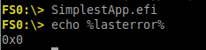

No imprime nada, que es lo esperado. `echo %lasterror%` (el `echo $?` de la Shell) muestra `0x0`, o sea el `EFI_SUCCESS` que devolvió `UefiMain`.

## 2.5 Las fases de arranque en el log

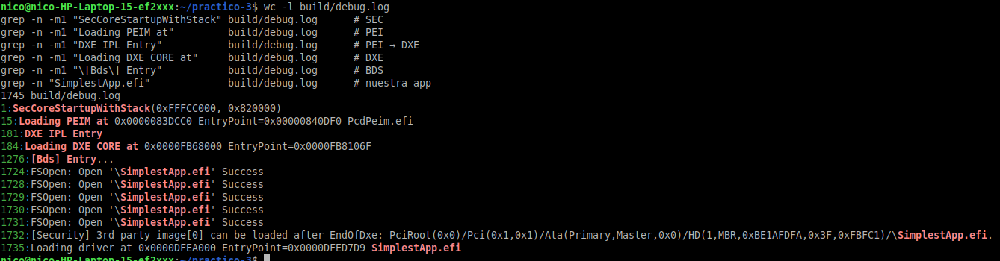

El log de ese arranque tiene 1745 líneas.

| Línea | Mensaje | Fase |
|---|---|---|
| 1 | `SecCoreStartupWithStack(0xFFFCC000, 0x820000)` | SEC |
| 15 | `Loading PEIM at 0x0000083DCC0 ... PcdPeim.efi` | PEI |
| 181 | `DXE IPL Entry` | PEI → DXE |
| 184 | `Loading DXE CORE at 0x0000FB68000` | DXE |
| 1276 | `[Bds] Entry...` | BDS |
| 1732 | `[Security] 3rd party image[0] can be loaded after EndOfDxe: ...\SimplestApp.efi` | BDS |
| 1735 | `Loading driver at 0x0000DFEA000 EntryPoint=0x0000DFED7D9 SimplestApp.efi` | nuestra app |

Los números de línea van en aumento: es la secuencia SEC → PEI → DXE → BDS del documento de la cátedra. Nuestra app aparece al final, y el DXE Core la carga con el mismo mensaje (`Loading driver at`) que a cualquier driver.

- La primera línea muestra que SEC arranca con la pila en `0x820000`, en la RAM temporal previa a que PEI inicialice la memoria principal.
- La línea 1732 es una verificación de seguridad: antes de ejecutar una imagen que no viene en el firmware (*3rd party*), el firmware decide si puede cargarla. Ese es el punto donde Secure Boot verificaría su firma.

---

# Parte 3: Hello World con la System Table

## 3.1 Ejecución

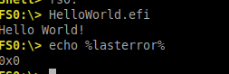

`HelloWorld.efi` imprime `Hello World!` y `%lasterror%` es `0x0`: el `EFI_STATUS` que devolvió `OutputString` y que `UefiMain` pasó como su propio valor de retorno.

## 3.2 El desensamblado de `UefiMain`

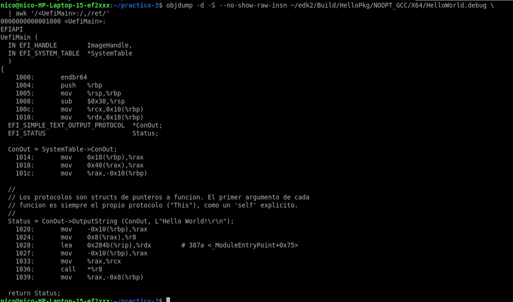

| Dirección | Instrucción | Qué muestra |
|---|---|---|
| `1004`–`1005` | `push %rbp` / `mov %rsp,%rbp` | prólogo, igual que en el TP #2 |
| `1008` | `sub $0x30,%rsp` | 32 bytes de shadow space para la función que vamos a llamar + 16 de variables locales |
| `100c`–`1010` | `mov %rcx,0x10(%rbp)` / `mov %rdx,0x18(%rbp)` | `ImageHandle` y `SystemTable` llegan en **`rcx` y `rdx`** (Microsoft x64) y se guardan en el shadow space, **arriba** de la dirección de retorno |
| `1018` | `mov 0x40(%rax),%rax` | `SystemTable->ConOut`: `ConOut` está en el offset `0x40` de `EFI_SYSTEM_TABLE` |
| `1024` | `mov 0x8(%rax),%r8` | `ConOut->OutputString`: segundo puntero del protocolo, offset `0x8` |
| `1028` | `lea 0x284b(%rip),%rdx` | segundo argumento: la cadena `L"Hello World!\r\n"`, en el RVA `0x387a` |
| `1033` | `mov %rax,%rcx` | primer argumento: `This` = `ConOut` |
| `1036` | `call *%r8` | **llamada indirecta**: la función está en el firmware y solo la conocemos por el puntero del protocolo |
| `1039` | `mov %rax,-0x8(%rbp)` | el `EFI_STATUS` vuelve en `rax` y se guarda en `Status` |

Los offsets `0x40` y `0x8` coinciden con las cuentas sobre las estructuras de la especificación (Parte 3.1 de la guía).

---

# Parte 4: Hello World con las bibliotecas de EDK2

## 4.1 Ejecución

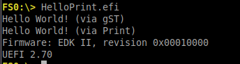

```
Hello World! (via gST)
Hello World! (via Print)
Firmware: EDK II, revision 0x00010000
UEFI 2.70
```

`gST` existe y vale lo mismo que `SystemTable` porque el constructor de `UefiBootServicesTableLib` la cargó antes de que se ejecutara `UefiMain`. `Print` formatea la cadena y termina llamando al mismo `OutputString`. El firmware es `EDK II`, revisión `0x00010000`, e implementa UEFI 2.70 (`Hdr.Revision = (2 << 16) | 70`).

## 4.2 Tamaños

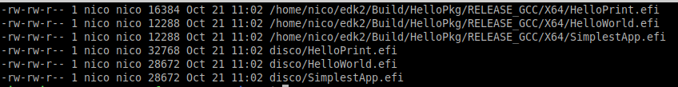

| | NOOPT (`-O0`) | RELEASE (`-Os` + LTO) |
|---|---|---|
| `SimplestApp.efi` | 28672 | 12288 |
| `HelloWorld.efi` | 28672 | 12288 |
| `HelloPrint.efi` | 32768 | 16384 |

- **El salto de `HelloWorld` a `HelloPrint` (4 KiB) es el costo de las bibliotecas.** `Print` arrastra `UefiLib`, `PrintLib`, `MemoryAllocationLib` y `DevicePathLib`.
- **`SimplestApp` y `HelloWorld` pesan lo mismo** porque las secciones se alinean a 4 KiB (`0x1000`). Los tamaños van de a 4096 bytes, y una llamada a `OutputString` no alcanza para ocupar otra página.
- **RELEASE pesa menos de la mitad que NOOPT.** Para depurar usamos NOOPT igual, porque el código sigue al fuente línea por línea.

---

# Parte 5: depuración con GDB

## 5.1 Dirección de carga

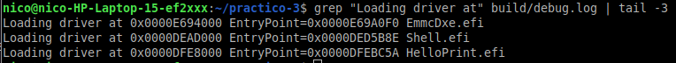

Esta captura es del arranque de la Parte 4, el último que había quedado en `build/debug.log`. Se ve la carga de la Shell (`0xDEAD000`) y de `HelloPrint.efi` (`0xDFE8000`), pero no la de `HelloWorld.efi`. Como QEMU reescribe el log en cada arranque, `make simbolos` no encontró la línea. Hicimos un arranque nuevo ejecutando `HelloWorld.efi`, y la línea que obtuvimos está en la captura de 5.3:

```
Loading driver at 0x0000DFEA000 EntryPoint=0x0000DFED805 HelloWorld.efi
```

La base de `HelloWorld.efi` (`0xDFEA000`) es la misma en la que se cargó `SimplestApp.efi` en la Parte 2 (2.5), que tiene el mismo tamaño. `HelloPrint.efi`, que tiene una página más, quedó en otra dirección. Con la misma configuración de QEMU, la dirección de carga depende de la secuencia de imágenes cargadas y de su tamaño, y por eso se repite entre arranques.

## 5.2 Secciones

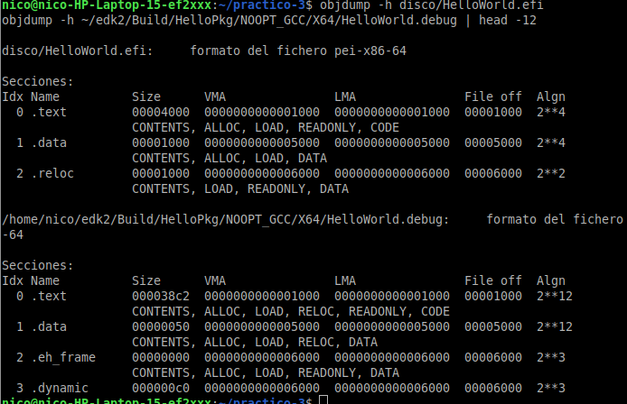

`.text` empieza en `0x1000` y `.data` en `0x5000`, con **las mismas VMA** en el `.efi` (PE, `pei-x86-64`) y en el `.debug` (ELF, `elf64-x86-64`). El linker script de EDK2 lo garantiza a propósito, para que los símbolos del ELF sirvan para el PE. En la lección 42 `.text` estaba en `0x240`: las versiones actuales de EDK2 alinean las secciones a 4 KiB.

## 5.3 Cálculo de las direcciones

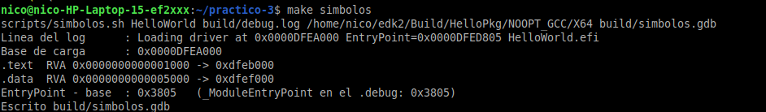

| | Cuenta | Resultado |
|---|---|---|
| `.text` | `0xDFEA000 + 0x1000` | `0xDFEB000` |
| `.data` | `0xDFEA000 + 0x5000` | `0xDFEF000` |
| control cruzado | `EntryPoint − base = 0xDFED805 − 0xDFEA000` | `0x3805` |

`0x3805` es justo la dirección de `_ModuleEntryPoint` en el `.debug`, así que la base es correcta. También confirma que el firmware entra a la app por `_ModuleEntryPoint` y no por `UefiMain`, que está al principio de `.text`, en el RVA `0x1000`.

## 5.4 Breakpoint en `UefiMain`

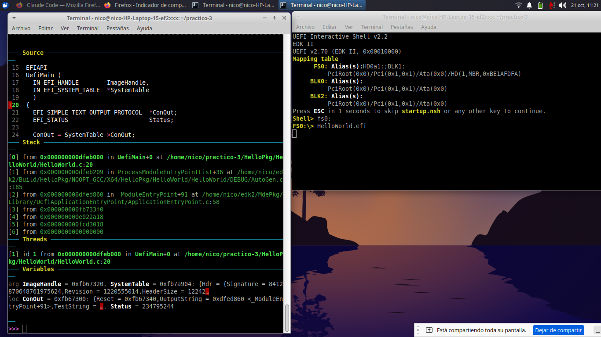

GDB frenó en `UefiMain+0` (`0xdfeb000` = base + `0x1000`), en la línea 20, antes del prólogo. QEMU quedó detenido después de `HelloWorld.efi`, sin imprimir todavía. El panel *Stack* muestra la cadena de llamadas:

```
[0] 0xdfeb000  UefiMain+0                     HelloWorld.c:20
[1] 0xdfeb209  ProcessModuleEntryPointList+36 AutoGen.c:185
[2] 0xdfed860  _ModuleEntryPoint+91           ApplicationEntryPoint.c:58
[3] 0xfb733f0  (firmware, sin símbolos)
```

`0xfb733f0` cae dentro del DXE Core, que se cargó en `0xFB68000` (Parte 2.5): es el código del firmware que ejecutó la imagen.

El panel *Variables* muestra `ImageHandle = 0xfb67320` y `SystemTable = 0xfb7a904`, con una firma sin sentido. Por la información de depuración, GDB lee esos argumentos de los dos primeros slots del shadow space, donde los guarda el prólogo. Como el prólogo todavía no se ejecutó, esos slots tienen lo que había antes. Se confirma en 5.5.

## 5.5 Antes del prólogo: lo que dejó el `call`

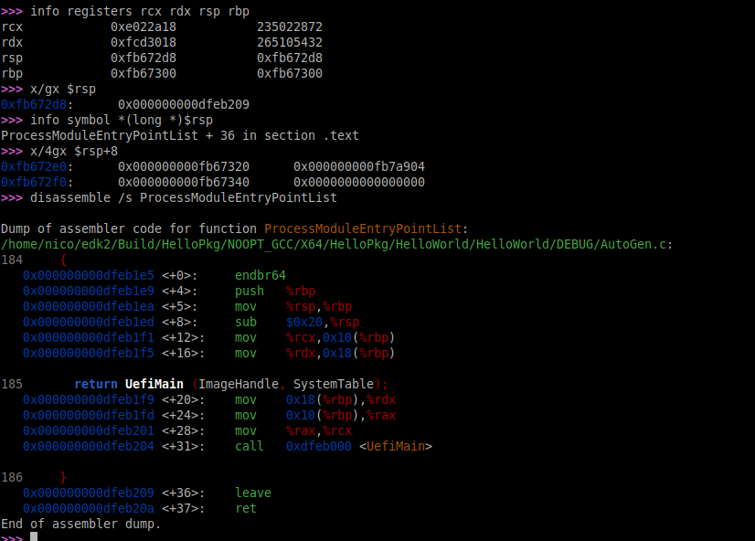

| | Valor | Qué es |
|---|---|---|
| `rcx` | `0xe022a18` | 1er argumento: `ImageHandle` |
| `rdx` | `0xfcd3018` | 2do argumento: `SystemTable` |
| `rsp` | `0xfb672d8` | cima de la pila |
| `[rsp]` | `0xdfeb209` | dirección de retorno: `ProcessModuleEntryPointList + 36` |
| `rbp` | `0xfb67300` | todavía es el `rbp` de `ProcessModuleEntryPointList` |
| `rsp+8` … `rsp+0x20` | `0xfb67320`, `0xfb7a904`, `0xfb67340`, `0x0` | shadow space, todavía sin escribir |

- Los argumentos están en **`rcx` y `rdx`**, como manda la convención Microsoft x64.
- La dirección de retorno `0xdfeb209` es la instrucción siguiente al `call 0xdfeb000 <UefiMain>` (`0xdfeb204`) en el desensamblado de `ProcessModuleEntryPointList`.
- `ProcessModuleEntryPointList` hace `sub $0x20,%rsp`: reserva **exactamente 32 bytes**, el shadow space y nada más. Las cuentas cierran: `0xfb67300 − 0x20 = 0xfb672e0`, y el `call` empuja la dirección de retorno, `0xfb672e0 − 8 = 0xfb672d8 = rsp`.
- Los dos primeros slots del shadow space (`0xfb67320` y `0xfb7a904`) son **exactamente** los valores que el panel *Variables* de 5.4 mostraba como `ImageHandle` y `SystemTable`.

## 5.6 Después del prólogo: el shadow space y la System Table

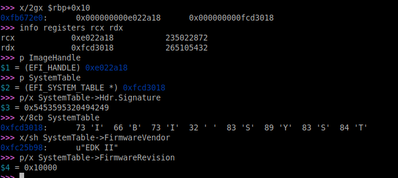

Después de `next` se ejecutó el prólogo:

| | Antes (5.5) | Después |
|---|---|---|
| `[0xfb672e0]` | `0xfb67320` | `0xe022a18` = `rcx` |
| `[0xfb672e8]` | `0xfb7a904` | `0xfcd3018` = `rdx` |

El prólogo (`mov %rcx,0x10(%rbp)` y `mov %rdx,0x18(%rbp)`) copió los argumentos al **shadow space**: la misma dirección `0xfb672e0` que en 5.5 era `rsp+8` ahora es `rbp+0x10`. Ahora `p ImageHandle` y `p SystemTable` dan `0xe022a18` y `0xfcd3018`, iguales a los registros.

La System Table se verifica sola:

- `Hdr.Signature = 0x5453595320494249`, que en memoria es `I B I   S Y S T` (`EFI_SYSTEM_TABLE_SIGNATURE`).
- `FirmwareVendor = u"EDK II"`, una cadena `CHAR16`.
- `FirmwareRevision = 0x10000`, igual a lo que imprimió `HelloPrint` en la Parte 4.

## 5.7 Antes del `call *%r8`

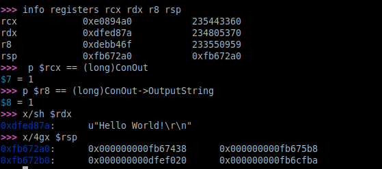

| | Valor | Qué es |
|---|---|---|
| `rcx` | `0xe0894a0` | `This` = `ConOut` (`p $rcx == (long)ConOut` → `1`) |
| `rdx` | `0xdfed87a` | la cadena: `x/sh $rdx` → `u"Hello World!\r\n"` |
| `r8` | `0xdebb46f` | `ConOut->OutputString` (`p $r8 == (long)ConOut->OutputString` → `1`) |
| `rsp` | `0xfb672a0` | cima de la pila de `UefiMain` |

- **La cadena está en nuestra imagen**: `0xdfed87a = 0xDFEA000 + 0x387a`, el mismo RVA que mostraba el `lea` del desensamblado (Parte 3.2).
- **`OutputString` no**: nuestra imagen ocupa de `0xDFEA000` a `0xDFF1000`, y `r8 = 0xdebb46f` está por debajo. Es código del driver de consola del firmware, y la única forma de llegar a él es el puntero que está en el protocolo.
- `rsp = 0xfb672a0 = 0xfb672d8 − 8 (push %rbp) − 0x30 (sub)`: los 32 bytes desde `rsp` son el shadow space que **`UefiMain`** reservó para `OutputString`, con los valores que había (`x/4gx $rsp`).

## 5.8 Retorno

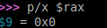

Después de `nexti` sobre el `call`, `rax = 0x0`: `OutputString` devolvió `EFI_SUCCESS`, que `UefiMain` guarda en `Status` y devuelve. En ese momento la terminal de QEMU muestra `Hello World!`, la misma salida de la Parte 3.1, y con `continue` la Shell vuelve al prompt.

---

# Parte 6: el Hello World en hardware real (bare metal)

En esta parte llevamos **los mismos `.efi` de las Partes 2 a 4, sin recompilar**, a una notebook real, y los ejecutamos desde la UEFI Shell arrancada desde un pendrive, antes de que exista ningún sistema operativo.

## 6.1 El equipo

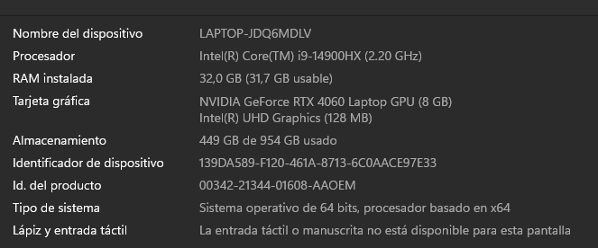

| | |
|---|---|
| Equipo | Lenovo Legion (`LAPTOP-JDQ6MDLV`) |
| Procesador | Intel Core i9-14900HX (x64) |
| RAM | 32 GB |
| Disco | SSD NVMe KIOXIA de 1 TB, con Windows |
| Firmware | **Insyde**, UEFI 2.80 (se ve en 6.6) |

Para compilar y preparar el pendrive usamos Ubuntu en una máquina virtual de VirtualBox, con EDK2 y BaseTools instalados como en la Parte 1. No hizo falta compilar OVMF.

## 6.2 Compilar las apps y la Shell

Las apps son las mismas de siempre (`make app`, target NOOPT). La Shell, en cambio, no la tomamos de OVMF: la compilamos desde `ShellPkg` en **RELEASE**.

```bash
build -p ShellPkg/ShellPkg.dsc -a X64 -t GCC -b RELEASE
```

La Shell de OVMF es DEBUG y escribe su log en el puerto de E/S `0x402`. En QEMU ahí está el debugcon, pero en una PC real no sabemos qué hay en ese puerto. La versión RELEASE no escribe nada.

## 6.3 Preparar el pendrive

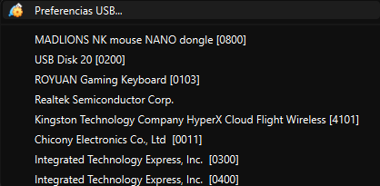

Desde *Dispositivos → USB* de VirtualBox le pasamos el pendrive a la VM, donde aparece como **`USB Disk 20`**. En Ubuntu lo identificamos con `lsblk`: es `sdb`, de 29,3 GB, removible. Lo formateamos en **FAT32**, el sistema de archivos que todo firmware UEFI está obligado a leer, y copiamos los archivos:

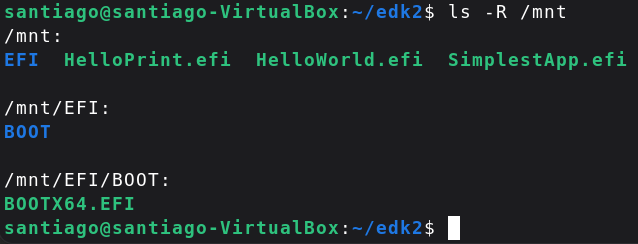

```
/mnt
├── EFI/BOOT/BOOTX64.EFI     ← la Shell, renombrada
├── HelloPrint.efi
├── HelloWorld.efi
└── SimplestApp.efi
```

Es la misma estructura que `make run` arma en `disco/` (Parte 2.3): la Shell va en la **ruta por defecto de medios removibles**, `\EFI\BOOT\BOOTX64.EFI`.

## 6.4 BitLocker

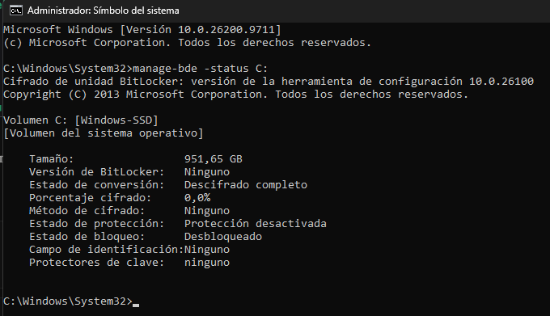

Antes de tocar Secure Boot verificamos BitLocker. Con BitLocker activo, cambiar la configuración de arranque hace que Windows pida la clave de recuperación. `manage-bde -status C:`, en una terminal de administrador, muestra:

| | |
|---|---|
| Volumen | `C:` [Windows-SSD], 951,65 GB |
| Estado de conversión | Descifrado completo (0,0 % cifrado) |
| Estado de protección | **Protección desactivada** |

El disco no está cifrado, así que se podía seguir sin suspender nada.

## 6.5 Desactivar Secure Boot

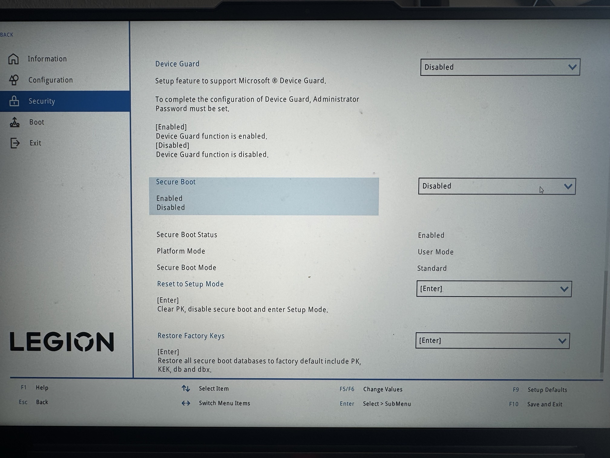

Entramos al setup del firmware con `shutdown /r /fw /t 0` y, en **Security**, pusimos **Secure Boot → Disabled**.

- **`Secure Boot Status` sigue en `Enabled`** en la misma pantalla. Ese campo muestra con qué configuración arrancó la máquina esta vez; el cambio se aplica recién después de guardar con F10 y reiniciar.
- `Platform Mode: User Mode` y `Secure Boot Mode: Standard` indican que hay una clave de plataforma (`PK`) instalada y que se usan las claves del fabricante.
- No tocamos **Reset to Setup Mode**, que borra la `PK`, ni **Restore Factory Keys**, que restaura `PK`, `KEK`, `db` y `dbx`. Son las variables de NVRAM con las que el firmware decide qué imágenes puede ejecutar (pregunta 3).

Con Secure Boot activo, el firmware verifica la firma Authenticode de cada imagen PE/COFF contra los certificados de `db` y la lista negra `dbx`. Nuestra Shell no está firmada, así que la rechazaría.

## 6.6 Arrancar desde el pendrive

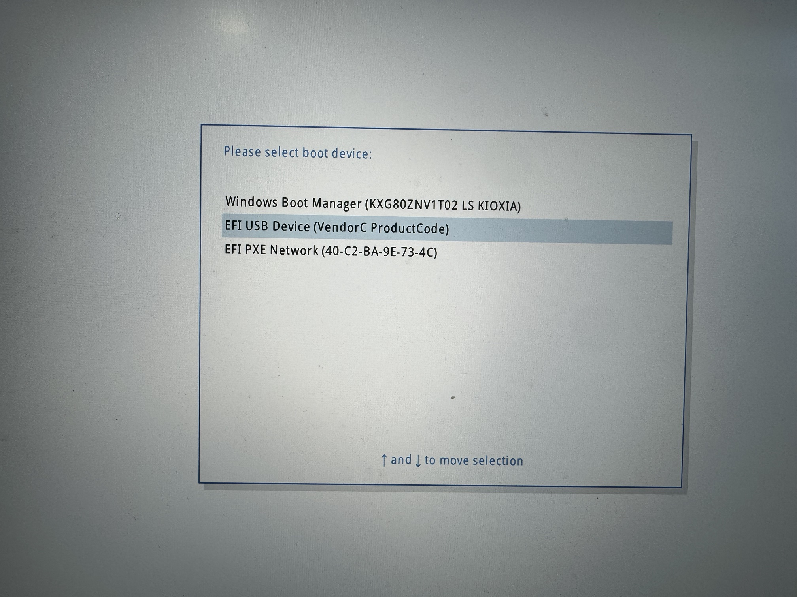

Con F12 al encender aparece el boot menu del firmware, con tres opciones:

| Opción | De dónde sale |
|---|---|
| `Windows Boot Manager (KXG80ZNV1T02 LS KIOXIA)` | una entrada `Boot####` de la NVRAM, que creó Windows al instalarse, apuntando a su cargador en el disco NVMe |
| **`EFI USB Device (VendorC ProductCode)`** | el pendrive. No tiene entrada `Boot####`: BDS lo ofrece porque encontró `\EFI\BOOT\BOOTX64.EFI` |
| `EFI PXE Network (40-C2-BA-9E-73-4C)` | arranque por red; el número es la MAC de la placa de red |

Es el equivalente real del Boot Manager de OVMF que vimos en la Parte 2.3.

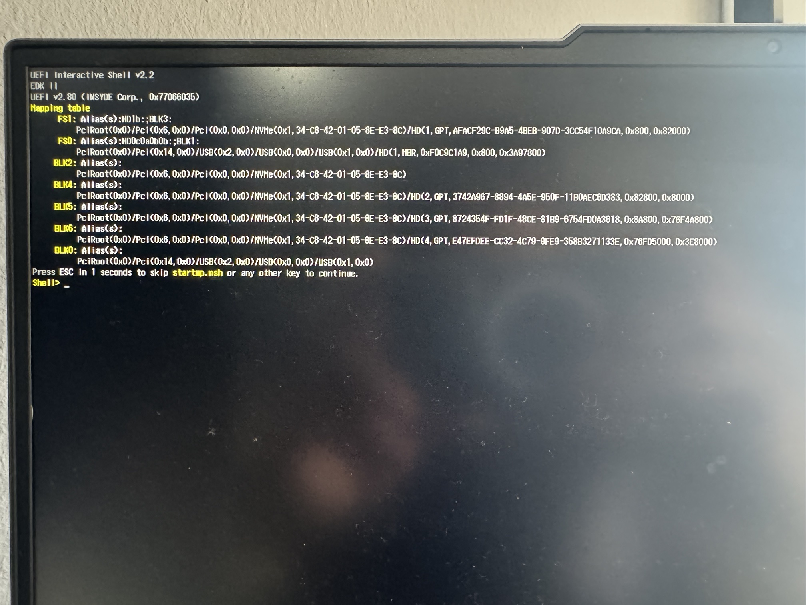

Al elegir el pendrive arranca la Shell. El encabezado ya muestra la diferencia con QEMU:

```
UEFI Interactive Shell v2.2
EDK II
UEFI v2.80 (INSYDE Corp., 0x77066035)
```

La Shell sigue siendo de EDK II, porque la compilamos nosotros, pero **el firmware ahora es Insyde** e implementa UEFI 2.80. En QEMU era EDK II (OVMF) con UEFI 2.70. Como el pendrive no tiene `startup.nsh`, la Shell queda en `Shell>` en lugar de pasar sola a `FS0:`.

## 6.7 Los dispositivos según el firmware

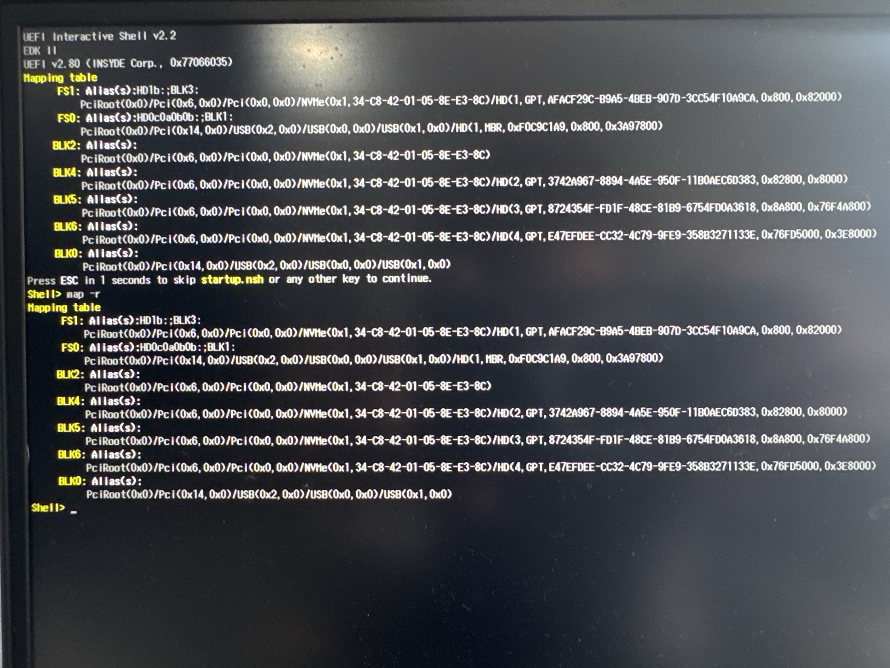

`map -r` muestra dos sistemas de archivos y varios dispositivos de bloque. Se distinguen por el *device path*:

| Mapeo | Device path (resumido) | Tamaño | Qué es |
|---|---|---|---|
| **`FS0:`** | `Pci(0x14,0x0)/USB(0x2,0x0)/USB(0x0,0x0)/USB(0x1,0x0)/HD(1,MBR,0xF0C9C1A9,0x800,0x3A97800)` | 29,3 GiB | el **pendrive**: controlador USB, tabla **MBR**, como lo formateamos |
| `FS1:` | `Pci(0x6,0x0)/Pci(0x0,0x0)/NVMe(0x1,...)/HD(1,GPT,AFACF29C-...,0x800,0x82000)` | 260 MiB | la **partición EFI de Windows** (FAT32), en el disco NVMe |
| `BLK2` | `.../NVMe(0x1,...)` | — | el disco NVMe entero |
| `BLK4` | `.../HD(2,GPT,...,0x82800,0x8000)` | 16 MiB | partición reservada de Microsoft (MSR) |
| `BLK5` | `.../HD(3,GPT,...,0x8A800,0x76F4A800)` | 951,65 GiB | la partición de Windows (`C:`) |
| `BLK6` | `.../HD(4,GPT,...,0x76FD5000,0x3E8000)` | 2000 MiB | partición de recuperación |
| `BLK0` | `.../USB(0x1,0x0)` | — | el pendrive entero |

Los tamaños salen del último número de `HD(...)`, que es la cantidad de sectores de 512 bytes. Por ejemplo, `0x76F4A800 × 512 = 951,65 GiB`, el mismo tamaño que informó `manage-bde` para `C:` en 6.4. Y `0x3A97800 × 512 = 29,3 GiB`, el tamaño del pendrive en `lsblk`.

Los `BLKx` sin `FSx` son particiones que la Shell no puede leer: NTFS u otros formatos sin driver de sistema de archivos en el firmware. Solo FAT tiene ese driver, por eso solo la partición EFI y el pendrive son `FSx:`. **No entramos a `FS1:`**, para no arriesgar el arranque de Windows.

## 6.8 Ejecutar las apps

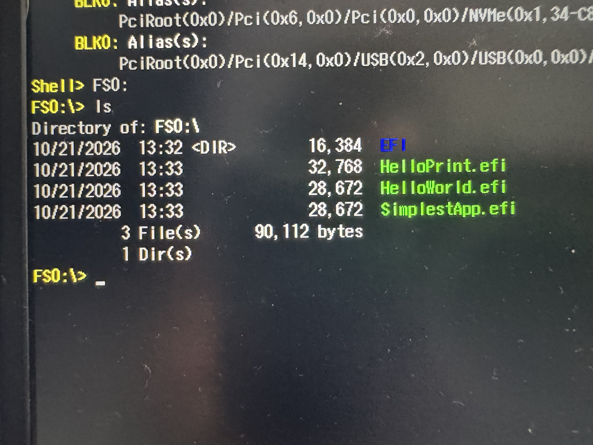

En `FS0:`, `ls` muestra el directorio `EFI` y las tres apps con **los mismos tamaños que en QEMU**: `HelloPrint.efi` 32.768 bytes, y `HelloWorld.efi` y `SimplestApp.efi` 28.672 (P2-01). Son los mismos binarios, sin recompilar.

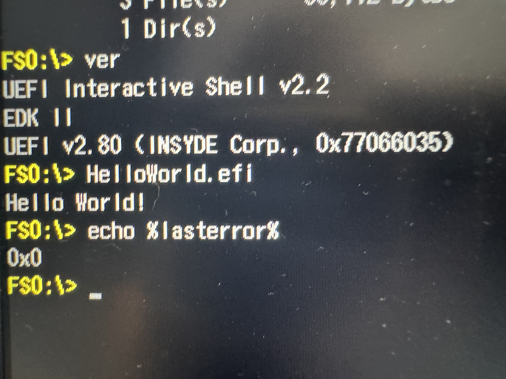

```
FS0:\> ver
UEFI Interactive Shell v2.2
EDK II
UEFI v2.80 (INSYDE Corp., 0x77066035)
FS0:\> HelloWorld.efi
Hello World!
FS0:\> echo %lasterror%
0x0
```

`HelloWorld.efi` imprime `Hello World!` y devuelve `EFI_SUCCESS`, igual que en QEMU (P3-01).

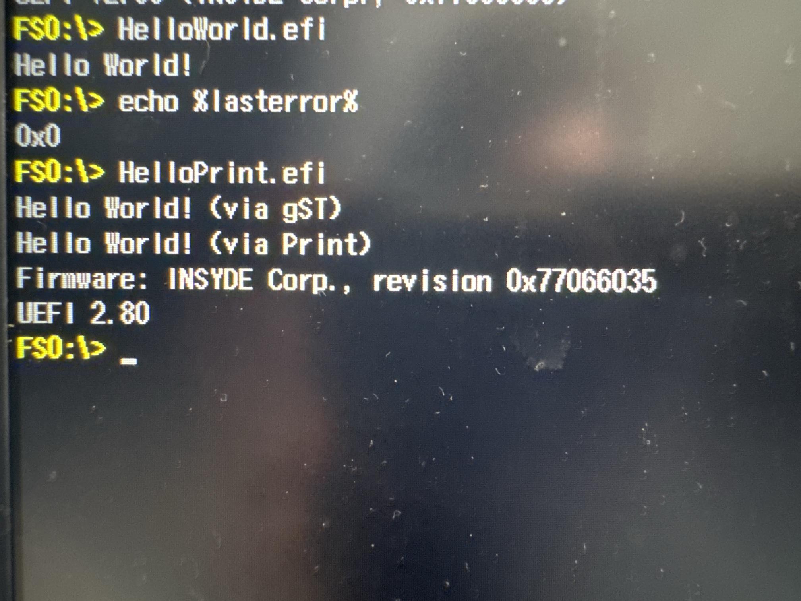

```
FS0:\> HelloPrint.efi
Hello World! (via gST)
Hello World! (via Print)
Firmware: INSYDE Corp., revision 0x77066035
UEFI 2.80
```

**Esta es la prueba más clara de la parte.** El código de `HelloPrint` no cambió, pero lo que imprime sí, porque lee la System Table del firmware que lo ejecuta:

| | QEMU + OVMF (P4-01) | Lenovo Legion (P6-11) |
|---|---|---|
| `gST->FirmwareVendor` | `EDK II` | `INSYDE Corp.` |
| `gST->FirmwareRevision` | `0x00010000` | `0x77066035` |
| `gST->Hdr.Revision` | UEFI 2.70 | UEFI 2.80 |

## 6.9 Dejar todo como estaba

Después de las pruebas, `reset` en la Shell, sacamos el pendrive y volvimos a poner **Secure Boot → Enabled** en el setup (F10 → Yes). BitLocker no hubo que reanudarlo porque estaba desactivado desde antes (6.4).

---

# Respuestas

## Preguntas de la Parte 6 (bare metal)

**1. ¿Por qué el mismo `HelloWorld.efi` corre sin cambios en OVMF y en el firmware de Insyde?**
Porque la app no depende de nada propio de OVMF ni del hardware: depende solo de la **especificación UEFI**, que los dos firmwares implementan.
- El formato es PE/COFF reubicable: cada firmware la carga donde quiere y aplica las reubicaciones de `.reloc`.
- Recibe la System Table como argumento, en `rdx` según la convención Microsoft x64, que también fija la especificación.
- Imprime a través del protocolo `ConOut`, que cada firmware implementa con su propio driver de consola.

Los tamaños idénticos en `ls` (P6-09) muestran que es el mismo binario, y `HelloPrint` muestra que lee una System Table distinta: Insyde 2.80 en lugar de EDK II 2.70 (P6-11 frente a P4-01).

**2. ¿Cómo encontró BDS la Shell en el pendrive si no había ninguna entrada `Boot####`?**
Por la **ruta por defecto de medios removibles**. Para un dispositivo sin opción de arranque propia, la especificación UEFI dice que BDS busque `\EFI\BOOT\BOOTX64.EFI` en su sistema de archivos FAT, y ahí estaba la Shell renombrada (P6-03). Por eso el boot menu ofrece `EFI USB Device` al lado de `Windows Boot Manager`, que sí es una entrada `Boot####` (P6-06). Es el mismo mecanismo que usamos en la Parte 2.3 para que OVMF arrancara la Shell desde `disco/`, donde el log mostraba `[Bds] Expand \EFI\BOOT\BOOTX64.EFI`.

**3. ¿Por qué el firmware rechazaría nuestra Shell con Secure Boot activo, y qué variables intervienen?**
Con Secure Boot activo, antes de ejecutar una imagen el firmware verifica su firma Authenticode, que va embebida en el PE/COFF. La cadena de confianza se arma con cuatro variables autenticadas de la NVRAM:
- **`PK`** (*Platform Key*): la clave del dueño de la plataforma, que autoriza cambios en `KEK`.
- **`KEK`** (*Key Exchange Keys*): las claves que pueden modificar `db` y `dbx`.
- **`db`**: los certificados y hashes permitidos (en esta máquina, los de Microsoft y Lenovo).
- **`dbx`**: la lista de imágenes y certificados revocados.

Nuestra Shell y nuestras apps no tienen ninguna firma, así que no coinciden con nada de `db` y el firmware las rechaza. Son las mismas claves que la pantalla de Secure Boot ofrece borrar o restaurar (P6-05). `Platform Mode: User Mode` indica que hay una `PK` instalada y que la verificación está en vigor.

**4. En `map -r`, ¿cómo se distingue el pendrive del disco de Windows?**
Por el *device path*, que describe el camino físico desde la raíz PCI hasta el dispositivo (P6-08):
- El pendrive cuelga del controlador USB, `Pci(0x14,0x0)`, con nodos `USB(...)`, y su partición es `HD(1,MBR,...)`, con tabla MBR.
- El disco de Windows cuelga de `Pci(0x6,0x0)`, con un nodo `NVMe(...)`, y sus particiones son `HD(n,GPT,<GUID>,...)`, con tabla GPT.

Además, el tamaño en sectores confirma cada uno: 29,3 GiB para el pendrive y 951,65 GiB para la partición `C:`, que coincide con `manage-bde` (P6-04).

## Preguntas de la Parte 7

**1. ¿Qué diferencia hay entre UEFI y PI? ¿En qué fase corre nuestra app y por qué todavía puede usar `ConOut`?**
UEFI es la especificación de la interfaz entre el firmware y los programas que corren sobre él: la System Table, los servicios y los protocolos. PI es la arquitectura interna con la que el firmware se construye desde el reset: SEC, PEI, DXE y BDS. Nuestra app es un consumidor de la interfaz UEFI y corre en BDS, lanzada por la Shell, después de toda la secuencia que vimos en el log (P2-05). Como nadie llamó a `ExitBootServices()`, los Boot Services y los protocolos de consola siguen disponibles.

**2. ¿Por qué el `.efi` es un PE/COFF y qué consecuencia tiene para depurar?**
La especificación UEFI define PE/COFF como formato de todas las imágenes (P2-02). El formato incluye la sección `.reloc`, y gracias a eso `LoadImage()` puede cargar la imagen en cualquier dirección. Para depurar, eso significa que la dirección de `UefiMain` no se conoce al compilar. Hubo que leerla del log de OVMF (`0xDFEA000`), sumarle el RVA de cada sección y cargar los símbolos del `.debug` con `add-symbol-file` (P5-03).

**3. ¿Qué convención de llamada usa UEFI en x64 y qué cambia respecto de System V?**
Usa Microsoft x64 (`EFIAPI` = `__attribute__((ms_abi))`). Los cuatro primeros argumentos van en `rcx`, `rdx`, `r8` y `r9`, en lugar de `rdi`, `rsi`, `rdx` y `rcx`. El llamador reserva 32 bytes de shadow space arriba de la dirección de retorno, y no hay red zone. Lo vimos en vivo:
- Los argumentos llegaron en `rcx`/`rdx` (P5-05).
- `ProcessModuleEntryPointList` reservó exactamente `0x20` bytes (P5-05).
- El prólogo de `UefiMain` copió los argumentos a esa zona (P5-06).
- La llamada a `OutputString` pasó `This` en `rcx` y la cadena en `rdx` (P5-07).
- El resultado volvió en `rax` (P5-08).

**4. ¿Qué es un protocolo y por qué la llamada a `OutputString` es indirecta?**
Un protocolo es una estructura de punteros a función (más datos) identificada por un GUID e instalada en un handle. `OutputString` la implementa el driver de consola del firmware, fuera de nuestra imagen (`r8 = 0xdebb46f`, por debajo de `0xDFEA000`, en P5-07). La app no conoce esa dirección al compilar: la lee del protocolo (`mov 0x8(%rax),%r8`) y salta con `call *%r8` (P3-02).

**5. ¿Quién llama a `UefiMain` y qué pasa antes?**
El firmware salta a `_ModuleEntryPoint`, el `EntryPoint` del log (`0x3805`, P5-03). `_ModuleEntryPoint` corre los constructores de las bibliotecas, que por ejemplo cargan `gST` en `HelloPrint` (P4-01), y después llama a `ProcessModuleEntryPointList`. Esa función, generada en `AutoGen.c`, es la que llama a `UefiMain`. El backtrace lo muestra (P5-04), y la dirección de retorno en la pila apunta a `ProcessModuleEntryPointList+36` (P5-05).

**6. ¿Para qué sirve cada archivo del paquete y qué hace `PACKAGES_PATH`?**
- El `.inf` describe un módulo: fuentes, tipo (`UEFI_APPLICATION`), punto de entrada (`UefiMain`) y las clases de biblioteca que usa.
- El `.dsc` describe la plataforma: qué módulos se compilan y qué implementación concreta se usa para cada clase de biblioteca.
- `PACKAGES_PATH` le indica a `build` en qué directorios buscar paquetes. Por eso `HelloPkg` puede vivir en nuestro repo y no adentro de `edk2`.

**7. ¿Qué implicaría ejecutar una app como esta sin Secure Boot?**
La app corre antes que el sistema operativo, con los privilegios del firmware, en modo largo sin protección entre procesos y con acceso a toda la memoria y al hardware. Además, puede usar `RuntimeServices` para modificar variables de la NVRAM, como el orden de arranque. El log muestra que el firmware evalúa cada imagen de terceros antes de ejecutarla (`[Security] 3rd party image[0] can be loaded`, P2-05). Sin Secure Boot, que verificaría la firma del PE/COFF en ese punto, cualquier `.efi` en un disco se ejecuta con esos privilegios. Ese es el escenario de los bootkits: código que se ejecuta antes que el SO y que el SO no puede ver.

---

# Conclusiones

1. **Una aplicación UEFI no tiene sistema operativo abajo.** No hay libc ni syscalls: todo lo que puede hacer lo obtiene del puntero a la System Table que le pasa el firmware.
2. **El arranque sigue las fases de PI.** El log de OVMF muestra SEC, PEI, DXE y BDS en ese orden, y nuestra app cargada al final, con el mismo mecanismo que cualquier driver.
3. **BDS decide qué se arranca.** Las versiones actuales de OVMF no arrancan solas su Shell interna. Para arrancarla desde nuestro disco hubo que usar la ruta por defecto de la especificación, `\EFI\BOOT\BOOTX64.EFI`.
4. **Los servicios del firmware se usan a través de protocolos.** Imprimir es leer `ConOut` en el offset `0x40` de la System Table, leer `OutputString` en el offset `0x8` del protocolo y hacer una llamada indirecta a código que está fuera de nuestra imagen.
5. **La convención de llamada es Microsoft x64, no System V.** Los argumentos van en `rcx` y `rdx`, el llamador reserva 32 bytes de shadow space y el resultado vuelve en `rax`. GDB lo mostró en cada paso, con direcciones concretas.
6. **El shadow space se ve en dos tiempos.** Antes del prólogo, los slots `0xfb672e0` y `0xfb672e8` tenían valores viejos, que GDB mostraba como si fueran los argumentos. Después del prólogo tenían `rcx` y `rdx`.
7. **Depurar una imagen reubicable requiere calcular su dirección.** Base de carga del log + RVA de la sección = dirección para `add-symbol-file`. El control cruzado `EntryPoint − base = _ModuleEntryPoint` confirma la cuenta.
8. **`UefiMain` no es el verdadero punto de entrada.** El firmware entra por `_ModuleEntryPoint`, que corre los constructores de las bibliotecas y llama a `UefiMain` a través de `ProcessModuleEntryPointList`.
9. **Usar bibliotecas tiene un costo.** `Print` agrega 4 KiB a la imagen, y la optimización de RELEASE la reduce a menos de la mitad.
10. **El mismo binario corre en hardware real.** `HelloWorld.efi` y `HelloPrint.efi` corrieron sin recompilar sobre el firmware Insyde de una Lenovo Legion. `HelloPrint` mostró otro firmware en la misma System Table: `INSYDE Corp.` y UEFI 2.80, en lugar de `EDK II` y UEFI 2.70. Para lograrlo bastó con la ruta por defecto `\EFI\BOOT\BOOTX64.EFI` y con desactivar Secure Boot, porque nuestras imágenes no están firmadas.
11. **Las lecciones de 2021 necesitaron adaptarse a EDK2 actual.** El toolchain pasó de `GCC5` a `GCC`, hay que declarar `StackCheckLib`, las secciones se alinean a 4 KiB, los submódulos son obligatorios y la Shell ya no arranca sola.

---

## Nota sobre las direcciones

Las direcciones absolutas (`0xDFEA000`, `0xfb672d8`, `0xfcd3018`, …) dependen de la versión de OVMF, de la memoria asignada a QEMU y de qué imágenes se cargaron antes. En otra máquina o con otras opciones van a ser distintas.

Lo que se mantiene son los **offsets** (`.text` en `0x1000`, `_ModuleEntryPoint` en `0x3805`, la cadena en `0x387a`, `ConOut` en `0x40`, `OutputString` en `0x8`) y las **relaciones** entre direcciones (base + RVA, `rbp+0x10 = rsp+8` antes del prólogo, `sub $0x20` del shadow space). En eso se apoya todo el análisis.
